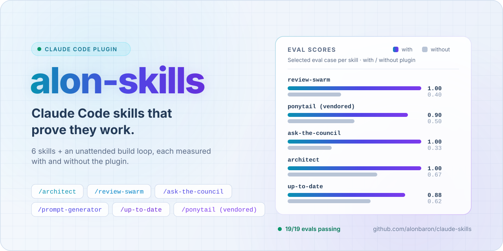
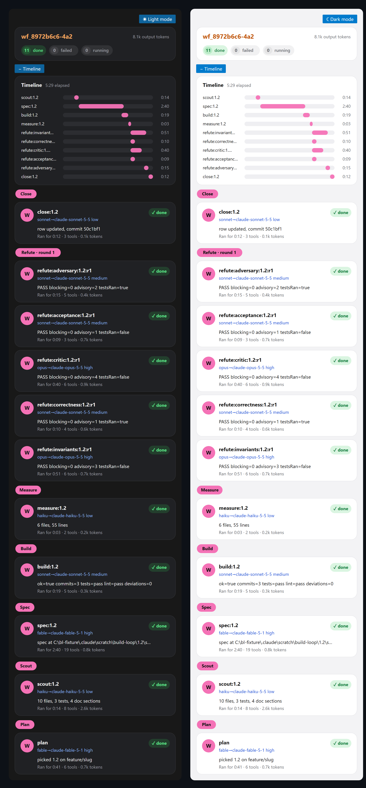

<p align="center">
  
</p>

<p align="center">
  &nbsp;
  &nbsp;
  &nbsp;
  <a href="#-evals"></a>&nbsp;
  &nbsp;
  <a href="https://github.com/alonbaron"></a>
</p>

<p align="center">
  <b>Six Claude Code skills and one unattended build loop, tuned to one engineering style: model-first, failure-path-aware, YAGNI.</b><br>
  <sub>Every skill is measured with and without the plugin, so the uplift is a number, not a promise.</sub><br>
  <sub>One install. Usable in the Claude Code CLI and the VS Code extension.</sub>
</p>

---

## ◢ Install

```text
/plugin marketplace add alonbaron/claude-skills
/plugin install alon-skills@alonbaron
```

The live session tracker is a second plugin in the same marketplace, optional: `/plugin install workflow-watch@alonbaron` (see [Watching a session or a run](#-watching-a-session-or-a-run)).

Pull updates anytime with `/plugin marketplace update alonbaron` — the marketplace tracks `main`, so you're always on the latest. [Tagged releases](https://github.com/alonbaron/claude-skills/releases) mark the milestones.

---

## ◢ Proof, not promises

Most skill packs ask you to trust them. This one runs each skill through a [`claude plugin eval`](https://code.claude.com/docs/en/plugin-evals) suite twice, once with the plugin and once without, and reports both. One selected eval case per skill:

| The situation | With the plugin | Without |
|---|---|---|
| A real diff with an N+1 query goes to **review-swarm**: parallel reviewers, verifiers, ranked report | **1.00** | 0.40 |
| Someone asks for a pluggable-backend cache interface with one caller; **ponytail** ships the simple version | **0.90** | 0.50 |
| A decision that should end by handing the build to another skill: **ask-the-council** | **1.00** | 0.33 |
| A feature spec from scratch: **architect** asks the few questions that matter and right-sizes the docs | **1.00** | 0.67 |
| A branch that was never pushed: **up-to-date** says so and compares against `main` instead of faking a sync | **0.88** | 0.62 |

All 19 cases pass at the 0.7 threshold, each measured on the skill text this release ships. Across 120 trigger prompts, each skill fired on 75 to 100% of the runs meant for it and never on the ones meant for something else. Full table and method under [Evals](#-evals).

<!-- GIF: a 20-second recording of review-swarm spawning its reviewers on a real diff goes here. -->

---

## ◢ The skills

| Skill | Invoke | What it does |
|---|---|---|
| **architect** | `/architect` | Design docs *before* code — domain model + invariants → failure-path design → API contracts → a sequenced workstream. `architect audit` checks existing docs against the code. |
| **review-swarm** | `/review-swarm` | Six parallel specialist reviewers on Sonnet → Opus verifiers that try to refute each finding → a ranked, `file:line` report. Never edits. |
| **ask-the-council** | `/ask-the-council` | Four (or six) Opus advisors forced to disagree, then a Chairman in the main thread who **commits** to one recommendation with the tradeoff named. |
| **prompt-generator** | `/prompt-generator` | Vague ask → rigorous prompt. Anti-hallucination, anti-tokenmaxing, strict agent rules baked into the prompt itself. |
| **up-to-date** | `/up-to-date` | Preflight repo sync + situational brief before you start. Read-only by default — never touches a dirty tree without your OK. |
| **ponytail** | `/ponytail` | Lazy-senior-dev mode: the simplest thing that actually works. *(MIT, vendored — see License.)* |

Each skill also triggers from plain language — e.g. *"spec this out before we build"*, *"swarm review this diff"*, *"ask the council whether…"*, *"catch me up on the repo"*, *"be lazy here"*.

**Proactive by default.** The skills fire on task *shape*, not just keywords: starting a new feature invokes **architect**, opening work in a repo with a remote invokes **up-to-date**, finishing a non-trivial implementation invokes **review-swarm**, a solution growing past the minimum invokes **ponytail** — announced in one line, no permission asked. Each skill carries a "when not to use" boundary so it stays out of the way on trivial work.

### Trigger map

| Skill | Fires on | Stays quiet on |
|---|---|---|
| architect | a new app, feature, or workstream with no design docs; "architect", "design doc", "spec this out", "roadmap", "audit the docs" | a small fix already covered by current docs; pure implementation of a designed phase |
| review-swarm | "review / check / assess this diff, branch, PR"; a non-trivial implementation just finished | a trivial diff (docs, rename, one-liner); "fix it" asks; security-only asks (`/security-review`); `/code-review` named explicitly |
| ask-the-council | high-stakes, expensive-to-reverse decisions with competing options; "ask the council", "get a panel" | fact-finding; one-obvious-answer calls; anything reversible in an afternoon |
| prompt-generator | a prompt, task spec, or "have it do X" destined for another agent or LLM; "write a prompt", "improve this prompt" | text a human will read; work you'll do yourself this session |
| up-to-date | work about to start in a repo with a remote; "up-to-date", "sync first", "pull latest", "catch me up" | a repo with no remote (one line, then start); a mid-task re-check |
| ponytail | a solution outgrowing the minimum: one-caller abstractions, a dependency for a few lines, scaffolding "for later"; "ponytail", "be lazy", "yagni", "do less" | trust boundaries; the full version explicitly asked; tidying an already-written diff (`/simplify`) |

---

## ◢ The build loop

`/alon-skills:build-loop` builds `TODO_WORKFLOW.md` rows one at a time without supervision, in any repo that carries the architect doc set. Each stage is a fresh subagent with an empty context; state between runs lives in the repo, never in chat. Fable 5.1 makes the calls everything downstream inherits (which row, what done means, who wins a dispute), Opus 5.5 reviews and repairs, Sonnet 5.5 builds, Haiku 5.5 searches and counts. Stages name model aliases, so each follows the newest model of its tier.

| Stage | Model | Reads | Writes | Returns | Stops the loop when |
|---|---|---|---|---|---|
| plan | fable, effort high | `TODO_WORKFLOW.md`, git status/branch/log, the `## Commands` table in `CLAUDE.md`, `<scratch>/<id>/plan.json` of a stale row | TODO row → `[IN PROGRESS]` (commit), the branch, `plan.json` | taskId, taskRow, branch, baseCommit, docsToRead, leftForThisTask, commands, resuming, stopReason, staleBlocked | dirty tree; `TODO_WORKFLOW.md` or `SOURCE_OF_TRUTH.md` missing; no `## Commands` table and no single root manifest; no eligible row (names the first two rejected); a stale `[IN PROGRESS]` row it cannot safely resume (closed `[BLOCKED]` for a human) |
| scout | haiku, low | grep/glob excerpts, doc headings | nothing | files with scope, tests, docSections, notes | returns nothing → row back to `[ ]` with a note |
| spec | fable, high | SoT sections, the scout's locations, existing `spec.md` when resuming | SoT → Roadmap → NN docs (committed when a fact changes), `<scratch>/<id>/spec.md` (8 sections, incl. acceptance criteria and unverified APIs) | specPath, docsChanged, unverifiedApis, verifyCommands, stopReason | a missing decision it refuses to guess → row back to `[ ]` with the decision named |
| research | sonnet, medium; skipped when unverifiedApis is empty | manifests, type definitions, context7 | `research.md` | researchPath, unverifiedRemaining | never |
| build | sonnet | `spec.md`, `research.md`, the files the spec names | code + tests, micro-commits, `build.md` | ok, commits, testsPassed, lintPassed, deviations, blockedReason | blockedReason or not ok → `[BLOCKED]`; budget below the build-to-close tail (only when the session set a token target) |
| measure | haiku, low; independent of the builder | `git diff --stat` and `--name-only` base..HEAD | nothing | filesChanged, linesChanged, docsOnly, touchesTrustBoundary, trustPaths, languages | never (a missing result assumes a trust boundary, so the security lens runs) |
| refute | correctness + acceptance on sonnet; invariants on opus; security on sonnet only when a trust-boundary path changed; adversary on sonnet round 1 only, skipped under 30 changed lines or docs-only, and run after the other lenses so its test file never races their test runs (writes one breaking test, keeps it uncommitted only if it fails); critic on opus round 1 only (spec vs the TODO row) | `spec.md`, `build.md`, the diff, the SoT invariants, the commands | nothing except the adversary's test file | per lens: verdict, testsRan, blocking, advisory | all lenses return nothing → `[BLOCKED]` |
| merge (script) | — | the lens votes | — | a cited `file:line` finding always blocks; an uncited `fail` counts as a vote and blocks only when two or more lenses agree; rounds 2+ run correctness, acceptance, invariants plus any lens that blocked the round before | — |
| arbiter | fable; only when a finding the fixer disputed comes back | the finding, the dispute, the diff | nothing | upheld or dismissed per finding, with a reason | never |
| fix | opus, high; at most `maxFixRounds` (default 2) | the blocking findings, `spec.md` | fixes + tests, commits (adopts the adversary's test) | fixed, notFixed (key + reason), commits | blocking findings still standing after the last round → `[BLOCKED]` |
| close | sonnet, low; the only writer of `TODO_WORKFLOW.md` and `docs/handoff.md`; runs on every exit after plan succeeded | `build.md`, `spec.md` §1 and §8, the outcome | the row's status and `Left for <id>: …` note, a newest-first `docs/handoff.md` entry, one commit; deletes an adversary test nobody adopted | ok, commit | — |

The only stop that means "run again" is `reached maxTasks`. Everything else means a human should look at `TODO_WORKFLOW.md` and `docs/handoff.md`.

**In a session:**

```text
/alon-skills:build-loop            # up to 3 tasks
/alon-skills:build-loop 1          # one task
/alon-skills:build-loop 2.1        # that row
/alon-skills:build-loop {"maxTasks":1,"models":{"build":"opus"},"skipLenses":["adversary"]}
```

Args and defaults: `maxTasks` 3 · `task` null · `models` {} (per-stage overrides: plan, scout, spec, research, build, measure, refute, invariants, critic, arbiter, fix, close) · `dryRun` false · `maxFixRounds` 2 · `skipLenses` [] · `scratch` `.claude/scratch/build-loop`.

One thing to know about in-session runs (measured 2026-10-04, CLI 2.1.289): the Workflow harness hands every subagent the prompt that started the turn, verbatim and with priority over the script's text. Start the loop from a message that says to run it; a message such as "wait for my approval" reaches the planner, which obeys it and stops before opening a branch. The headless driver below is unaffected, since its prompt is the driver's own.

**Unattended, one fresh process per task:**

```text
node <plugin-root>/scripts/autobuild.mjs --tasks 5 [--task 2.1] [--dry-run] [--repo <path>] [--config <path>] [--plugin-dir <path>]
```

The driver runs `claude -p` with `--permission-mode auto` once per task, asks it to run the workflow with `maxTasks: 1`, parses the JSON it returns, and stops on anything but `reached maxTasks`, on a non-zero exit, or on a usage-limit reply. `--config` defaults to `<repo>/.claude/build-loop.json` and is merged into the workflow args, so per-repo model overrides live there. A lock file under `<repo>/.claude/scratch/build-loop/` stops two drivers from running on the same tree; the log is `autobuild.log` next to it. While a session runs, each stage is printed as it starts and finishes when Claude Code's workflow journal is where the driver expects it; that layout is internal, so the driver goes quiet rather than failing when it is not.

**What the repo needs** (the architect skill's templates carry all of it): `TODO_WORKFLOW.md` rows of `# | Task | Architecture Ref | Status | Branch` with the five status strings, `SOURCE_OF_TRUTH.md`, a `## Commands` table in `CLAUDE.md` (Scope | Install | Test | Lint | Format; the loop never guesses a package manager or a test command), and the `Left for <id>: …` note convention. `docs/handoff.md` is created on the first close.

**Unattended runs and review-swarm.** A skill that sets its own tool rules (review-swarm, up-to-date) is refused in don't-ask mode unless the Skill tool is pre-approved, e.g. `--allowedTools Skill`. Interactive sessions just ask. Measured 2026-09-24.

**Measured once, 2026-09-23:** `autobuild.mjs --tasks 1` on a throwaway Node repo with a two-row TODO built row 1.1 in about four minutes: plan, scout, spec, build (two commits, tests green), measure, four refute lenses (all pass, five advisory notes), close. The driver reported $1.75 for the session. The driver runs every session with `{"attribution": {"commit": "", "pr": "", "sessionUrl": false}}`, so its commits carry no `Co-Authored-By` or `Claude-Session` trailer (measured: 3/3 commits had both without it, 0/3 with it, and a second build-loop task came out clean). Running `/alon-skills:build-loop` in your own session uses your settings instead; put the same `attribution` block in `~/.claude/settings.json` to get owner-only commits there too.

---

## ◢ Watching a session or a run

<p align="center"></p>

The tracker follows any open session, not only Workflow runs, and shows everything that happens while an agent builds: main-thread turns (`TURN`), skills fired (`SKILL`), spawned subagents (`AGENT`, such as parallel review-swarm lenses and verifiers or council advisors), git commits (`COMMIT`), and Workflow stages (`STAGE`). The picture is the `Tracker` pane from workflow-watch in its dark and light themes. A header card holds the counts and output tokens, a timeline plots the last ten items on a shared clock, and every item then gets a rounded card, newest first, under a pill naming its phase (`Turn N`, `Skill · <name>`, or the Workflow phase). `scripts/tracker.mjs` draws the same feed as an HTML page, in run order: a header KPI strip, a **Timeline Waterfall** colored by model tier and outcome, and a card per item with metric pills (duration, tool calls, output tokens) and a fold that reveals the span bar, the tool call trail (`Bash`, `Read`, `Grep`, etc.) and the full output. Only running items start open. Three ways to get it:

- **`scripts/tracker.mjs`**, from any shell: `node <plugin-root>/scripts/tracker.mjs [--session <id> | --run <dir|wf_id>] [--source auto|claude|antigravity] [--out tracker.html] [--png tracker.png] [--watch]`. With no flags it picks the newest session across both agents: Claude Code (CLI and VS Code extension) under `~/.claude/projects/<project>/`, and Antigravity (VS Code extension, IDE and 2.0) under `~/.gemini/antigravity/brain/<conversation-id>/`. `--source` limits the search to one of them. `--session <id>` (or an id prefix) renders that session's full activity feed: `<session>.jsonl`, `<session>/subagents/agent-*` and any `workflows/<run>/journal.jsonl` for Claude Code, or the conversation's transcript plus each spawned subagent's own conversation for Antigravity (read from the untruncated `transcript_full.jsonl` when present). `--run` renders a single workflow run, by directory or by its `wf_…` name. `--png` adds a screenshot via Playwright (`--playwright <path>` when not in default module resolution). `--watch` re-renders every five seconds, until the last stage ends for a workflow run, or until Ctrl+C for a session.
- **In VS Code** (the Claude Code extension or the Antigravity extension): run `node scripts/tracker.mjs --watch` in the integrated terminal and open `tracker.html` with **Simple Browser** or **Live Preview**. With `--watch` the page reloads itself every five seconds and keeps your scroll position and open folds. The header pill names the source (`CLAUDE CODE · SESSION TRACKER`, `ANTIGRAVITY · SESSION TRACKER`), and Gemini models get their own `gemini` badge and bar color.
- **`mods/workflow-watch`**, inside Claude Code: a mod (a plugin of function hooks) that opens on `session.start` and follows the active session and its workflows live in the `Tracker` pane beside the chat. It draws nothing else, so the chat gets no band above the prompt, status line entry or toasts. In VS Code and the desktop app the pane is drawn as rounded cards, newest first, with a dark/light toggle and a timeline you can fold. `/plugin install workflow-watch@alonbaron`, or `claude --plugin-dir mods/workflow-watch` for one session; `/tracker` (or `/workflow-watch`) opens the pane and prints the report as text. On Windows it finds the home directory from `USERPROFILE` when `HOME` is unset, as in the VS Code extension host.

The picture above is one build-loop task on a throwaway Node repo, run on 2026-10-12 with `autobuild.mjs --tasks 1`: row 1.2, `truncateSlug(slug, max)`. It took 11 stages: plan, scout, spec, build, measure, five refute lenses and close. The loop skipped research because the spec listed no unverified APIs, and it needed no fix round because every lens passed with no blocking finding. The run took 5:29 and 8.1k output tokens, and the driver reported $4.29 for the session. The row closed as `[FINISHED - PENDING MERGE]` after six commits, all authored by the owner with no trailer. Every alias resolved as documented (fable → `claude-fable-5-1`, opus → `claude-opus-5-5`, sonnet → `claude-sonnet-5-5`, haiku → `claude-haiku-5-5`), and every stage recorded its effort level, with scout and measure at `low` on Haiku 5.5. Two of the loop's rules came from the v3.1 run: the fixer may not dispute a finding the arbiter upheld, and the build stage names its effort (`medium`) instead of inheriting the launching session's.

---

## ◢ Evals

`evals/` is a [`claude plugin eval`](https://code.claude.com/docs/en/plugin-evals) suite: 19 behavioral cases, three per skill (four for ponytail), each with a skill-fired grader, a PASS/FAIL rubric on the result, and a process grader wherever the behavior is a tool fact (which model a subagent was spawned with, that no file was edited). Fixtures are real git repos built by `fixture.sh` scaffolds.

```text
claude plugin eval <absolute path to this repo> --runs 2 -j 4 --allow-tools Write Edit --scaffold --model claude-fable-5-1 --judge-model sonnet --no-publish --trust-plugin --threshold 0.7 --json
```

`--runs 2`, with and without the plugin; 19 of 19 cases pass at 0.7. Every case was measured again for v3.2 on Fable 5.1 on the GitHub runner, 2026-10-14 and 2026-10-15. ponytail, ask-the-council and prompt-generator ran in run 38520925302 ($34.03 API-equivalent, 9 of 10 at 0.7). architect, review-swarm and up-to-date took three runs ($57.10 together, 8 of 9 at 0.7): 38523993370 hit the plan's session limit, and the eight cases it spoiled were run again in 38690586571 and 38727606834. v3.2.1 changed two skills and re-measured them on 2026-10-19: review-swarm's security hand-off in 39206713941 ($7.18), and all three ask-the-council cases in 39207379482 ($24.76). v3.2.2 changed review-swarm's description again and re-ran all three of its cases on 2026-10-19, since the description steers triggering on every one: 39210606875 ($19.05) measured the security hand-off and the trivial diff, and 39245286149 ($22.14) re-ran the ranked report after the first run hit the plan's session limit on it. The other four skills are unchanged since those runs. Each run's summary is on the `eval-results` branch under `results/<run id>.txt`. Details in `evals/README.md`, per-case history in [`evals/history/STEP7.md`](evals/history/STEP7.md); the 2026-10-04 numbers are in [`STEP5.md`](evals/history/STEP5.md) and [`STEP6.md`](evals/history/STEP6.md):

| Skill | Cases | With plugin | Without | Model |
|---|---|---|---|---|
| ponytail | 4 | 0.90 (pushback), 0.83 (trust boundary), 1.00 (defers to simplify), 1.00 (root cause) | 0.50, 0.83, 1.00, 1.00 | Fable 5.1 |
| ask-the-council | 3 | 1.00 (declines low stakes), 0.90 (forces divergence), 1.00 (hands off after verdict) | 0.75, 0.70, 0.33 | Fable 5.1 |
| prompt-generator | 3 | 0.93 (coding-agent prompt), 1.00 (human prose boundary), 1.00 (whole-build scope check) | 0.71, 1.00, 0.67 | Fable 5.1 |
| architect | 3 | 1.00 (audit), 1.00 (new feature), 1.00 (small fix) | 1.00, 0.67, 0.88 | Fable 5.1 |
| review-swarm | 3 | 1.00 (ranked report), 1.00 (security hand-off), 1.00 (trivial diff) | 0.40, 0.33, 1.00 | Fable 5.1 |
| up-to-date | 3 | 1.00 (dirty and behind), 0.88 (no upstream), 1.00 (no remote) | 0.70, 0.62, 1.00 | Fable 5.1 |

architect, review-swarm and up-to-date run shell commands when they load, so their cases need a working bwrap sandbox; `.github/workflows/evals.yml` runs them on a GitHub runner with a `CLAUDE_CODE_OAUTH_TOKEN` secret, on Fable 5.1 by default (`workflow_dispatch` takes a model for a comparison run; the 2026-09-29 Opus 5.5 pass is in [`STEP5.md`](evals/history/STEP5.md)). Several cases score as well without the plugin; they guard boundaries (when a skill must stay quiet) rather than measure uplift.

Three readings of the in-container run. pushback-on-abstraction scored 0.90 with the plugin and 0.50 without. Both with-plugin runs finished; one without-plugin run hit the case's 15-turn cap. On 2026-10-04 neither with-plugin run named the trigger for upgrading the cache, and this time one did. (The 2026-10-04 write-up said the with-plugin runs hit the turn cap there. They didn't: they finished in 8 and 7 turns, and the two that hit it were the runs without the plugin.) forces-divergence fell to 0.70 because one with-plugin run hit the 900 s limit before the chairman wrote anything a judge could grade; the v3.2.1 re-run scored 0.90. And on refuses-trust-boundary the ponytail skill didn't fire in either with-plugin run, same as on 2026-10-04, which is the boundary that case guards.

security-alone-hands-off scored 0.67 with the plugin and 0.33 without on 2026-10-15, the same as on 2026-10-04. In both with-plugin runs, Fable reviewed the file in one pass instead of naming `/security-review`. The skill used to say only "hand off to /security-review". It now says not to swarm, to tell the user `/security-review` is the tool for this, and to run or recommend it. The 2026-10-19 re-run scored 0.83 against 0.33. The hand-off grader passed in one of the two with-plugin runs, so the fix helped without settling it. In the run that failed, Fable reviewed `src/middleware/auth.js` in one pass and never named the tool. The skill doesn't fire on this ask, so its body never loads and only the description can steer the answer, and the description never said where the name goes. v3.2.2 says it: the answer opens by naming `/security-review`, and a one-pass review may follow that line but never replaces it. The re-run scored 1.00 against 0.33, with the hand-off grader passing in both with-plugin runs.

hands-off-after-verdict dropped from 0.83 to 0.67 with the plugin (0.17 without) on 2026-10-14. Both with-plugin verdicts stopped without naming a next step. The skill's output spec ended at the dissent, so the chairman never reached the hand-offs, and both verdicts kept the current design, a case the hand-offs didn't cover. v3.2.1 closes every verdict with a named next step and covers that case. The re-run scored 1.00 against 0.33, with the hand-off grader passing both runs.

Two cases the session limit spoiled on 2026-10-04 now have clean numbers. real-diff-ranked-report scored 1.00 against 0.40: every grader passed in both with-plugin runs, and the runs without the plugin missed the ranked-report shape, the sonnet reviewers and the opus verifiers. no-remote-boundary scored 1.00 in both arms.

Trigger accuracy (120 queries, 20 per skill, half should fire, each run twice, on Fable 5.1 on a local machine, 2026-10-17 and 2026-10-18). Out of 20 should-fire runs per skill, architect fired on 18, ask-the-council 17, ponytail 17, prompt-generator 15, review-swarm 16 and up-to-date 20. No skill fired on a should-not query. The architect queries and 19 of the ask-the-council ones ran with a budget of 6 turns and 180 s per run. The rest ran with 3 turns and 90 s, which is enough to catch the first Skill call. From 2026-10-18 the grader also stopped counting a same-named skill from another namespace, because a session can list claude.ai custom skills called ponytail and prompt-generator. Per-run detail is in [`STEP7.md`](evals/history/STEP7.md).

---

## ◢ Living with Claude Code's built-ins

A skill that fires when a built-in should have, or stays quiet because a built-in got there first, is a bug even when both are good on their own. The overlaps are settled inside the descriptions, so the choice gets made at trigger time instead of after you already have the wrong answer.

| Overlap | Who wins | Why |
|---|---|---|
| **ponytail** vs `/simplify` | split | ponytail governs what gets *built*, before and while you write it. `/simplify` cleans a diff that already exists. |
| **review-swarm** vs `/code-review` | review-swarm | It's the default for a real diff. `/code-review` takes over when you name it, or for a one-liner not worth a swarm. |
| **review-swarm** vs `/security-review` | depends on the ask | Security is one of the swarm's six lenses. When security is the whole question, `/security-review` goes deeper. |

If you also run a UX skill or a prose skill, two hand-offs are worth wiring: review-swarm passes UI and accessibility hunks to the design reviewer instead of guessing at them, and architect's executive summaries are prose worth humanizing. Its tables, invariants, and API contracts are not.

---

## ◢ Companion skills

Not shipped here and not mine. Two third-party skills the hand-offs above are written against, if you want somewhere for them to go. Install them separately.

| Skill | Source | Pairs with |
|---|---|---|
| **ux-designer** | [szilu/ux-designer-skill](https://github.com/szilu/ux-designer-skill) (MIT) | review-swarm, which passes UI and accessibility hunks to it |
| **humanizer** | [blader/humanizer](https://github.com/blader/humanizer) (MIT) | architect, for executive summaries and README prose |

One catch worth knowing about humanizer: as of v2.9.1 the plugin puts `SKILL.md` at its root instead of `skills/humanizer/SKILL.md`. Claude Code installs it, reports it enabled, and never loads it. Copy `SKILL.md` out of `~/.claude/plugins/cache/humanizer/humanizer/<version>/` into `~/.claude/skills/humanizer/` and it works.

---

## ◢ What's new in workflow-watch 0.4

- The tracker lives only in its side pane. The band above the prompt, the status line entry, the toasts and the "pane not placed" log line are gone.
- In VS Code and the desktop app every item is a rounded card: a round avatar in its kind color, a state pill, and an amber outline while it runs. Cards come newest first, so the live work stays in view.
- A button switches the cards between dark and light whatever the system theme is, and another folds the timeline. Both choices carry over to new sessions.
- Turn cards show your prompt. A message sent while Claude works stays in the same turn as `(mid-turn) …`, and an interrupt ends the turn instead of opening a fake one.
- A session log past the 4 MiB read limit no longer blanks the pane. It's read through a filter that drops the engine's bookkeeping lines and pasted image data and cuts long strings, so a 12 MiB log comes to about 1 MiB. If a read still fails, the pane keeps the last items and says so.
- `scripts/tracker.mjs` follows the same turn rules: an interrupt ends the turn, and a mid-turn message stays in it.

## ◢ What's new in v3.2.2

- review-swarm: when security is the whole ask, the answer now opens by naming `/security-review`. Any one-pass review of its own comes after that line, not instead of it. security-alone-hands-off went from 0.83 to 1.00, and the hand-off grader passed in both with-plugin runs instead of one (run 39210606875).
- The other two review-swarm cases were re-run because the description affects triggering on all of them. Both held at 1.00 (runs 39210606875 and 39245286149).

## ◢ What's new in v3.2.1

- Every eval case passes: 19 of 19 at 0.7, up from 17. The two skills that changed were measured again on 2026-10-19 (runs 39206713941 and 39207379482).
- review-swarm: when security is the whole ask, it no longer swarms. It tells you `/security-review` is the tool for that, then runs it or recommends it. security-alone-hands-off went from 0.67 to 0.83.
- ask-the-council: every verdict ends with a named next step, or says why none applies yet. A verdict that keeps the current design says no architect update is needed and names the tripwire that would reopen it. hands-off-after-verdict went from 0.67 to 1.00.

## ◢ What's new in v3.2

- The `haiku` alias now resolves to `claude-haiku-5-5`, which records an effort level, so the build loop's scout and measure stages run at `low`. Haiku 4.5 recorded none.
- `scripts/tracker.mjs` draws a run as a feed of cards, one per stage. Refute and fix dividers carry their round number. A stage that died before returning (a session limit, an API error) shows as `✗ no result` instead of running forever, and `--watch` stops once the last stage ends.
- workflow-watch 0.2.0 draws the same blocks in its pane, band and status line. Stage times come from each stage's own transcript, so a run the mod finds already under way still shows how long every stage took.
- The eval summary opens with `valid N of M` and a `re-run:` line. A case is INVALID when a limit, an auth failure or a lost judge call spoiled it, TRUNCATED when a run hit the case's own turn or time budget, and NOT RUN when a stopped run never reached it. The CI job takes an `only` input to re-run named cases, and each published summary records the CLI version.
- Every behavioral case was measured again on Fable 5.1 for this release (17 of 19 passed at 0.7), and the 120 trigger queries were run again. The numbers are in the Evals section above.

## ◢ What's new in v3.1

- 3.1.1: every eval case now carries a Fable 5.1 number from 2026-10-04 (two runs on the GitHub runner, summaries published to the `eval-results` branch by CI); the CI job takes a case set (`sandboxed`, `in-container`, `all`) and gives the review swarm 1500 s; the one-off cron entries are gone.
- `scripts/tracker.mjs` renders any workflow run as a stage table, HTML or PNG, live with `--watch` (v3.2 redraws it as a feed of cards).
- `mods/workflow-watch`, a second plugin in this marketplace: the same stages drawn live inside Claude Code (pane, band, status line, toasts, `/workflow-watch`).
- build-loop: the fixer is told which findings the arbiter upheld and cannot dispute them twice; the build stage names its effort; the in-session caveat about the harness relaying the turn's prompt is documented in the script and above.
- The eval CI runs the nine sandboxed cases on Fable 5.1 (`workflow_dispatch` takes a model input for comparison runs); the table above now carries Fable numbers for every skill.

## ◢ What's new in v3

v3 rewrites all six skills for Claude Fable 5.1, adds a workflow that builds TODO rows on its own, and ships an eval suite so the skills can be measured instead of trusted. The pieces:

- Every `SKILL.md` was rewritten for Claude Fable 5.1: judgment rules with the reason attached, instead of numbered procedures the model no longer needs. Frontmatter splits `description` (what it does) from `when_to_use` (when it fires and when it stays quiet), and the combined length stays under the listing's truncation limit.
- The skills now spawn with explicit models: review-swarm reviewers on Sonnet and verifiers on Opus, council advisors on Opus. Naming the model in the spawn makes the behavior the same on every install, whatever the local subagent default is.
- `effort: max` is pinned on architect, ask-the-council, and review-swarm, the three judgment-heavy skills.
- review-swarm and up-to-date pre-approve the read-only git and gh commands they always run, and review-swarm has editing tools switched off for the duration of the review.
- Context injection: up-to-date runs its whole git and GitHub block before the model reads the skill and reasons over the output; review-swarm sees the working tree's status and diff shape; architect sees which design docs exist, so create-vs-audit mode is known before the first tool call.
- The shared "global rules" block is gone from every skill. One portable line replaces it (verify or say you don't know; commits are the repo owner's alone), because installers without a CLAUDE.md still need those two rules.
- The architect templates gained what the build loop reads: a `## Commands` table in `CLAUDE.md`, the `Left for <id>` note convention, and `docs/handoff.md`.
- New: `workflows/build-loop.js` and `scripts/autobuild.mjs` (above), and the `evals/` suite.

---

## ◢ What they share

- **Lead with the answer.** Output budgets, no filler, no restating the question.
- **Verify or say "I don't know".** No invented files, APIs, or facts.
- **Read before you edit.** Small, reversible changes over rewrites.
- **Design the failure paths** as deliberately as the happy ones; enforce rules at the core.
- **Question whether the code needs to exist at all** before writing it.

---

## ◢ Manage

```text
/plugin list                            # what's installed
/plugin disable alon-skills@alonbaron   # turn off without uninstalling
/plugin uninstall alon-skills@alonbaron
```

---

## ◢ License

MIT — see [LICENSE](LICENSE). The **ponytail** skill is vendored from the third-party [DietrichGebert/ponytail](https://github.com/DietrichGebert/ponytail) (MIT, © Dietrich Gebert) and redistributed under the same terms; third-party attribution is recorded in [NOTICE](NOTICE).

<p align="center">
  <sub>Built by <a href="https://github.com/alonbaron">@alonbaron</a> · <b>Build the model. Define the rules. Then write the code.</b></sub>
</p>
